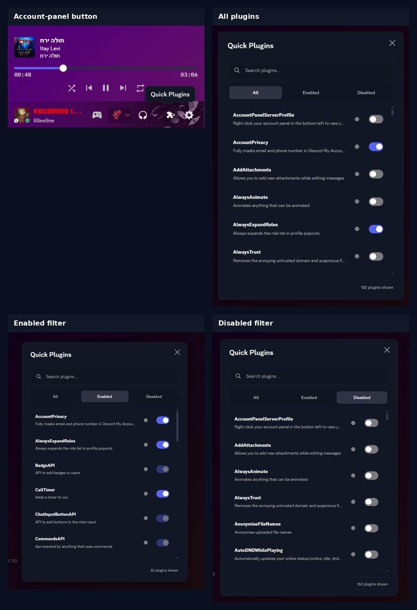

# QuickPlugins

## Preview

  

Click the image to view it at full resolution.

## Installation (Vencord source build)

This repository contains **Vencord userplugin source code**. It is not a standalone extension and is not loaded by the standard Vencord Installer.

1. Set up a Vencord source checkout using the official Vencord development instructions.
2. Copy the `quickPlugins` folder into `src/userplugins/`.
3. From the Vencord repository root, run `pnpm test:ts` and `pnpm build --dev`.
4. Follow Vencord's official development instructions to install/activate the locally built version. Building alone does not install it into Discord.
5. Enable **QuickPlugins** in Vencord's plugin settings.

Back up your existing setup before replacing an installed Vencord build. Do not run commands you do not understand.

## Compatibility

Requires a compatible Vencord source version. Discord/Vencord UI and internal API changes may require maintenance. This source has not been independently compiled or tested by this repository publication.

## Files

- `quickPlugins/index.tsx`
- `quickPlugins/styles.css`

## License

GPL-3.0-or-later. See [LICENSE](LICENSE).
